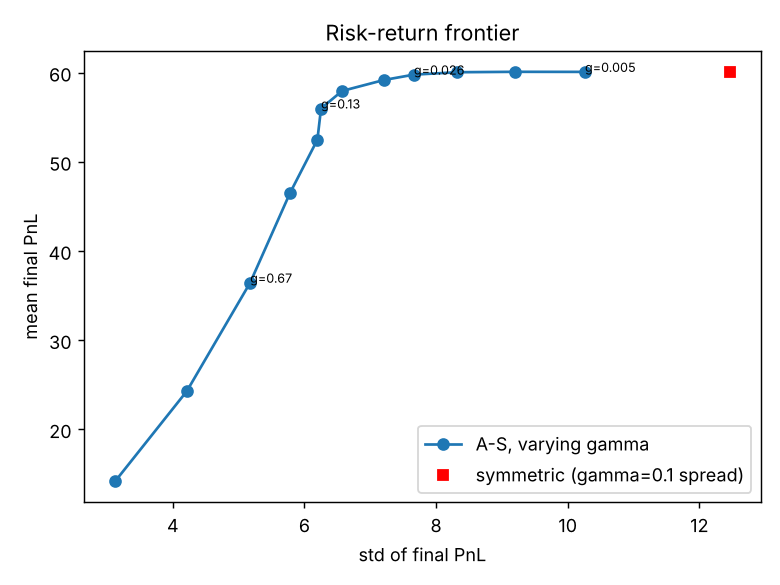
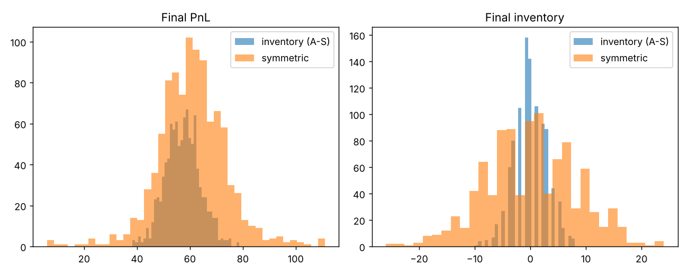

# Market Making with Inventory Risk (Avellaneda–Stoikov)

A from-scratch implementation and Monte Carlo study of the market-making model in
**Avellaneda & Stoikov (2008), "High-frequency trading in a limit order book", *Quantitative Finance* 8(3)**.

A market maker posts a bid and an ask around the mid-price and earns the spread when both sides fill.
The risk is **inventory**: a run of buys leaves it long just as the price may fall. The paper's answer is to quote
around a *reservation price* `r = s − q·γ·σ²·(T−t)` that leans against the current inventory `q`, with an optimal total spread
`γσ²(T−t) + (2/γ)·ln(1 + γ/k)`.

## What is in this repo

| Path | Content |
|---|---|
| `src/mm/model.py` | Reservation price, optimal spread, inventory-aware and symmetric quoting rules, fill probabilities |
| `src/mm/simulate.py` | Vectorised simulator (binomial mid-price, Poisson fills with intensity `A·e^(−kδ)`), optional hard inventory limits |
| `scripts/run_experiments.py` | Paper comparison + three extension experiments, writes `results/` |
| `tests/` | 8 unit tests (formula limits, inventory control, limit enforcement, reproducibility) |
| `REPORT.md` | Short paper-style write-up |
| `INTERVIEW_GUIDE.md` | Plain-English explanation and likely interview questions |

## Key results (1,000 simulated sessions, paper parameters: s₀=100, T=1, σ=2, dt=0.005, k=1.5, A=140)

| γ | Strategy | Mean PnL | Std PnL | Std final inventory |
|---|---|---|---|---|
| 0.01 | inventory-aware | 60.2 | 9.3 | 5.4 |
| 0.01 | symmetric | 60.5 | 13.3 | 8.5 |
| 0.1 | inventory-aware | 57.2 | **6.5** | **3.0** |
| 0.1 | symmetric | 60.8 | 12.8 | 8.2 |
| 0.5 | inventory-aware | 42.3 | 5.5 | 2.0 |
| 0.5 | symmetric | 54.0 | 11.0 | 7.0 |

- At γ = 0.1 the inventory-aware quotes give up **~6% of mean PnL** but cut PnL volatility by **~49%** and the spread of
  final inventory by **~64%** — the same trade-off the paper reports.
- Hard inventory limits on top of the model barely matter at |q| ≤ 10 or 5, but at |q| ≤ 2 they cost ~7% of PnL for a further
  ~56% cut in inventory dispersion.
- Liquidity matters most: as `k` rises from 0.5 to 6 (fills fall off faster with distance), optimal spreads shrink from 3.8 to 0.5
  and mean PnL falls from 177 to 12.

Full tables: [`results/summary.md`](results/summary.md) · raw numbers: [`results/results.json`](results/results.json)




## Run it

```bash
pip install -r requirements.txt
python -m unittest discover -s tests -v
python scripts/run_experiments.py --paths 1000     # ~2 s on a laptop
```
